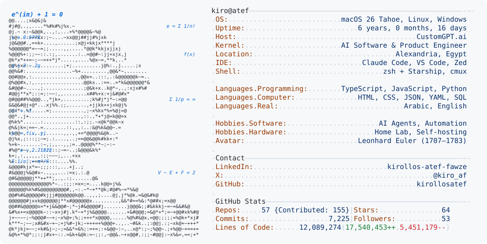

<!-- GitHub hides a link whose href ends in #gh-dark-mode-only / #gh-light-mode-only when the
     theme doesn't match (and it follows the GitHub theme setting). The <source> only switches
     to the tall card on phones. -->
<a href="https://github.com/kirollosatef#gh-dark-mode-only">
  <picture>
    <source media="(max-width: 600px)" srcset="dark_mobile.svg">
    
  </picture>
</a>
<a href="https://github.com/kirollosatef#gh-light-mode-only">
  <picture>
    <source media="(max-width: 600px)" srcset="light_mobile.svg">
    
  </picture>
</a>
